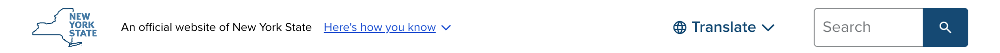

# NY State Universal Navigation (UNav)

 

UNav features:

- A NYS-branded banner
- A trust bar - explaining how to identify an official NY.gov site and how to know that a site is secure
- A translation language switcher configured for multiple Translation as a Service providers
- A search field
- An embedded alert system for State-wide alerts and calls to action

## Getting Started

What you need to do depends on your site:

- **Drupal sites on Acquia Site Factory, managed by WebNY:** Nothing. WebNY manages the UNav setup for these sites.
- **New applications:** Use `nys-unavheader` and `nys-unavfooter` from the [NYS Design System](https://designsystem.ny.gov) component library `npm install @nysds/components @nysds/styles`. It supports native HTML, React, Angular, and Vue. See [Building a new application](/notes/implementation.md#building-a-new-application).
- **Existing sites using the 2024 script embed:** Switch to the UNav bundle. See the [Implementation Guide](/notes/implementation.md).

> [!IMPORTANT]
> **Currently use translation?** The current translation services and the translated language subdomains (for example, `es.its.ny.gov`) will stop working on **December 31, 2026**. No redirects are set up. To link to a translation, add `?ljs=` to your URL with the language code. For example `https://its.ny.gov/?ljs=es`. Request a Localize key from [translation@its.ny.gov](mailto:translation@its.ny.gov). See [Moving off Smartling](/notes/translate.md#moving-off-smartling).

- [Frequently Asked Questions](https://bit.ly/unav-intake) — Answers to common questions about the updated UNav, from timing to policy clarifications.

## Technical Details

- [Implementation Guide](/notes/implementation.md) — Loading the components, header and footer settings, events, and migrating from the script embed.
- [UNav Search](/notes/search.md) — Domain-scoped search, using your own search page, and hiding search.
- [UNav Translate](/notes/translate.md) — How the language selector works, Localize, moving off Smartling, and hiding the language selector.
- [Alerts and CTA](/notes/alerts.md) — How the UNav handles alerts in the header and statewide calls-to-action (CTAs) in the footer.

> [!CAUTION]  
> The UNav should only be used on official NYS websites or applications that are hosted a ny.gov domain and secured with HTTPS encryption. If you have questions about whether your site is eligible to use the UNav, please contact the NYS Design System Team via our [intake form](https://bit.ly/unav-intake).

## Questions

Questions and exception requests can be submitted to the NYS Design System Team via our [intake form](https://bit.ly/unav-intake).
