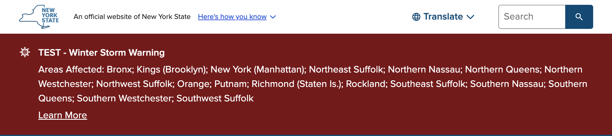
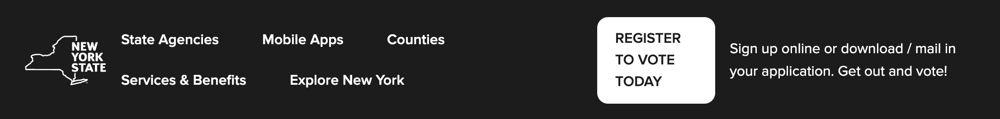

# UNav Alerts and Calls-to-Action (CTAs)

The UNav includes spaces for statewide alerts in the header and statewide calls-to-action (CTAs) in the footer. This is designed so that important and timely messaging can be delivered across all New York State sites consistently and effectively.

Alerts and CTAs aren't configurable. Sites don't opt in or out, and they don't author the content. There's nothing to add to your page beyond `<nys-unavheader>` and `<nys-unavfooter>`.

## Alerts in the Header

The header includes a space for urgent or time-sensitive information (for example, weather alerts and emergency notifications). These alerts are centrally managed and are displayed across all state websites that use the UNav. Each alert has a heading, a description, a severity, and optionally an icon and a link to more information.

Alerts are hidden by default and shown only while one is published. Each published alert appears as its own full-width band at the bottom of the header.

**Header Alert Example:**



The header reads the alert feed every time the page loads, and doesn't cache it. When an alert is turned off, it disappears on the next page load.

> [!IMPORTANT]
> An alert adds height to the header. Design your page so content below the header can shift down. Don't give the header a fixed height or position page content assuming its height.

## Calls-to-Action in the Footer

The footer includes a space for statewide calls-to-action (CTAs) that are relevant to all New York State residents (for example, voter registration and public health campaigns). Like alerts, these CTAs are centrally managed and are displayed across all state sites that use the UNav.



The footer reads the CTA feed on its own. It doesn't need the header to be on the page.

## Where the feeds come from

Feed | Production
:--- | :---
Alerts | `https://alerts-cta.static-assets.ny.gov/alerts.json`
CTA | `https://alerts-cta.static-assets.ny.gov/cta.json`

If your site sends a Content Security Policy, add `https://alerts-cta.static-assets.ny.gov` to `connect-src`. If a feed can't be reached, the header and footer still render without the alert or CTA.

### Previewing dev and stage feeds

To preview alerts and CTAs on a dev or stage site, set `data-environment` on `<body>`:

```html
<body data-environment="stage">
```

Value | Feed host
:--- | :---
`dev` | `alerts-cta-dev.static-assets.ny.gov`
`stage` | `alerts-cta-stage.static-assets.ny.gov`
Anything else, or no attribute | `alerts-cta.static-assets.ny.gov` (production)

The attribute is read once, when the component loads. Don't ship `data-environment` to production.
