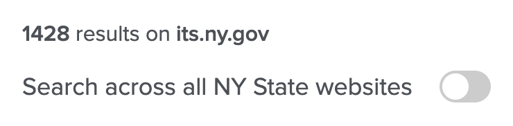

# UNav Search

The search that is built into the UNav header is designed to provide a consistent search experience across all New York State websites.


Search is shown by default. On wide screens it's an inline search field. On narrow screens it collapses to a search button that opens the field below the header.

## How It Works

When a visitor submits a search, the header sends them to the statewide search service at `search.its.ny.gov`, scoped to the domain they searched from. In other words, if a visitor searches while on a page on the `its.ny.gov` domain, the results come from `its.ny.gov`.

Users can also expand that search to include results from all NY state sites:



## Using your own search page

To send searches to your site's own search results page, set `searchUrl`. The header URL-encodes the query and appends it to the end of this value, so include the query parameter.

```html
<nys-unavheader searchUrl="https://example.ny.gov/search?q="></nys-unavheader>
```

A search for `snow days` goes to `https://example.ny.gov/search?q=snow%20days`.

## Handling search in JavaScript

To run search without a page redirect (for example, in a single-page application), listen for `nys-search-submit` and call `preventDefault()`. The query is in `event.detail.query`.

```html
<nys-unavheader id="unav"></nys-unavheader>
<script>
  document.querySelector("#unav").addEventListener("nys-search-submit", (event) => {
    event.preventDefault();
    router.push(`/search?q=${encodeURIComponent(event.detail.query)}`);
  });
</script>
```

## Hiding search

Some websites or applications need search to live somewhere else on the page. In these cases, hide search in the UNav with the `hideSearch` attribute. [More details in the implementation guide.](/notes/implementation.md)

```html
<nys-unavheader hideSearch></nys-unavheader>
```

> [!NOTE]
> The script embed hid search by default. The component shows it by default, so add `hideSearch` if your site had search off.
