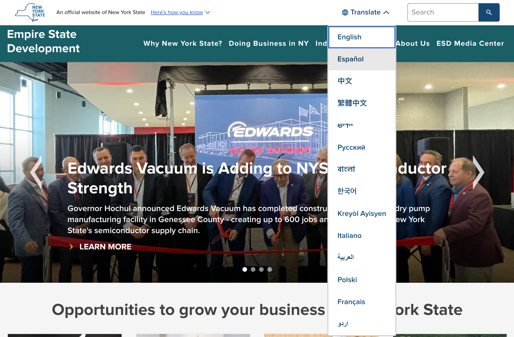

# UNav Language Selector

The language selector in the UNav header is designed to enhance the user experience for multilingual visitors by providing easy access to a range of languages in compliance with [New York State's Language Access Law](https://ogs.ny.gov/new-york-state-language-access-law).

Languages available by default in the language selector: English, Español, 中文, 繁體中文, יידיש, Русский, বাংলা, 한국어, Kreyòl Ayisyen, Italiano, العربية, Polski, Français, and اردو.

The language selector is in the header only. It's shown by default.



## How It Works

The header supports two translation services. Which one it uses depends on whether you set `translateKey`.

### Localize

Set `translateKey` to your Localize project key. The header loads LocalizeJS and translates the page in place, without a redirect.

```html
<nys-unavheader translateKey="{{YOUR_LOCALIZE_KEY}}"></nys-unavheader>
```

- The visitor's language is remembered on later visits.
- Arabic, Urdu, and Yiddish switch the page to right-to-left.
- When a visitor picks a language other than English, the header shows a dismissible machine-translation disclaimer in that language, directly below the header.

### Smartling (fallback)

With no `translateKey`, each language in the menu is a link to the same page on that language's subdomain. Selecting Español on `agency.ny.gov/about` goes to `es.agency.ny.gov/about`. Selecting English removes the language subdomain. The path, query string, and hash are kept.

```html
<nys-unavheader></nys-unavheader>
```

> [!WARNING]
> Not all state websites are set up to work with Smartling. The subdomain links only work on sites configured for the state's Smartling Global Delivery Network (GDN). If your site uses neither Smartling nor Localize, hide the language selector.

## Handling language selection in JavaScript

To translate with another service, listen for `nys-language-select` and call `preventDefault()`. The selected language is in `event.detail.language`.

```html
<nys-unavheader id="unav"></nys-unavheader>
<script>
  document.querySelector("#unav").addEventListener("nys-language-select", (event) => {
    event.preventDefault();
    myTranslator.setLanguage(event.detail.language.code);
  });
</script>
```

## Changing the list of languages

Set the `languages` property from JavaScript. Each language takes:

Field | Description
:--- | :---
`code` | The language code, for example `es`. Also used as the Smartling subdomain and the Localize language code.
`label` | The name shown in the menu, written in that language, for example `Español`.
`nativeText` | The name in English, for example `Spanish`. Screen readers announce it after the label.
`url` | Optional. A link for this language. Overrides both Smartling and Localize for this language.
`disclaimer` | Optional. HTML shown as the machine-translation disclaimer when this language is picked with Localize.

```html
<nys-unavheader id="unav"></nys-unavheader>
<script>
  document.querySelector("#unav").languages = [
    { code: "en", label: "English", nativeText: "English" },
    { code: "es", label: "Español", nativeText: "Spanish", url: "https://example.ny.gov/es/" },
    { code: "fr", label: "Français", nativeText: "French", url: "https://example.ny.gov/fr/" },
  ];
</script>
```

Setting `languages` replaces the whole default list. Include English so visitors can switch back.

## Hiding the language selector

If your site doesn't offer translation, hide the selector with the `hideTranslate` attribute. [More details in the implementation guide.](/notes/implementation.md)

```html
<nys-unavheader hideTranslate></nys-unavheader>
```

## Testing locally

Smartling links need a hostname to add a subdomain to. On `127.0.0.1`, the links point back at the current page and the header logs a warning. Test on `localhost` or another hostname instead.
